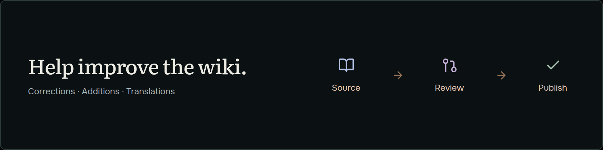

  <a href="https://tld.wiki">
    <picture>
      <source media="(prefers-color-scheme: dark)" srcset="docs/brand/wordmark-dark.svg">
      <source media="(prefers-color-scheme: light)" srcset="docs/brand/wordmark-light.svg">
      
    </picture>
  </a>

<strong>The wiki for Top-level Domains.</strong>

  <picture>
    <source media="(max-width: 600px)" srcset="docs/brand/community-mobile.png">
    
  </picture>

## Make a suggestion

Choose a form, include the relevant page and link your sources. The form opens directly on GitHub.

| Suggestion | Submit |
| --- | --- |
| Correct a page | [Suggest an edit](https://github.com/tld-wiki/community/issues/new?template=edit.yml) |
| Add a registrar | [Suggest a registrar](https://github.com/tld-wiki/community/issues/new?template=registrar.yml) |
| Add a submission destination | [Suggest a backlink destination](https://github.com/tld-wiki/community/issues/new?template=backlink.yml) |
| Add an extension | [Suggest an extension](https://github.com/tld-wiki/community/issues/new?template=tld.yml) |
| Correct a translation | [Improve a translation](https://github.com/tld-wiki/community/issues/new?template=translation.yml) |

A GitHub account is required. Check [existing suggestions](https://github.com/tld-wiki/community/issues) first.

Maintainers verify sources and review suggestions before publication. An issue never changes the site automatically. New registrars also need integration and verification.

Prices, availability and premium classification come from automated checks. To report a wrong result, use **Suggest an edit** with the affected URL and evidence.

[Contribution guidelines](CONTRIBUTING.md) · [Report a security issue](SECURITY.md) · [Open tld.wiki](https://tld.wiki)
